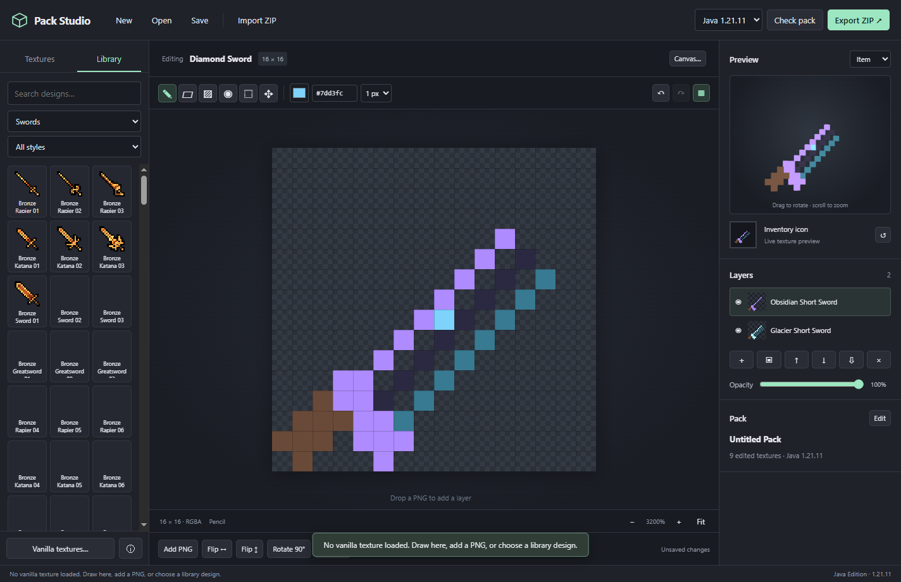

# Pack Studio

A C++20 desktop editor for Minecraft Java Edition resource packs, with an embedded HTML/Canvas/WebGL interface. Unofficial; not affiliated with Mojang or Microsoft.

## Download

Download **[PackStudio.exe from the latest release](https://github.com/myhticc/Pack-Studio/releases/latest)**. The portable Windows x64 application includes its browser runtime and 570 offline designs. The initial release is approximately 301 MiB.



## Use

Run `PackStudio.exe`. No installer, administrator access, account or separate browser installation is needed. On first launch the bundled WebView2 runtime is unpacked into `%LOCALAPPDATA%\PackStudio`. Projects are local `.packstudio` archives. The exported `.zip` goes into Minecraft's `resourcepacks` folder.

Select a Java Edition version, choose a texture, then draw, drop a PNG or add library artwork. The library is offline. Vanilla textures can be loaded from a local Minecraft client JAR or explicitly downloaded from Mojang; downloads are checked against the official SHA-1 and size.

The editor supports layers, opacity, selection and movement, undo/redo, nearest-neighbor transforms, color adjustment and replacement, palette mapping, item extrusion, block face assignment and worn armor UV templates. Inventory armor icons and worn armor textures are separate targets. Merely viewing a texture does not override it in the exported pack.

Shortcuts: B pencil, E eraser, G fill, I eyedropper, M selection, V move, Delete clear selection, Escape deselect, Ctrl+Z undo, Ctrl+Y redo, Ctrl+S save, Ctrl+O open. Double-click a layer name to rename it.

## Compatibility

24 stable Java Edition releases: 1.20–1.20.6, 1.21–1.21.11, 26.1–26.1.2, 26.2 and 26.3. Metadata and worn armor texture paths are generated for the exact selected version. Snapshot releases are excluded. Imported arbitrary custom models are preserved but are not automatically migrated between Minecraft versions; the editor previews standard item, cube and humanoid meshes. Six-face model generation is limited to the full-cube blocks explicitly listed by the editor.

PNG textures up to 4096 pixels wide and 16 million pixels total are supported; animated strip images may be taller. ZIP import is limited to 25,000 entries, 64 MB per entry and 512 MB expanded. Projects with large imported packs need sufficient RAM. An export check distinguishes errors from warnings and blocks errors. Minecraft-compatible third-party formats not understood by the standard preview remain available in the imported files.

## Build from source

Build-time dependencies are Python 3.12 or newer with Pillow and a portable LLVM-MinGW toolchain. The app itself contains no Python or Node runtime. Run from this folder:

```
python -m pip install -r requirements-build.txt
python scripts/bootstrap.py
python scripts/versions.py
python scripts/assets.py
python scripts/build_library.py
python scripts/build.py --package
```

Bootstrap retrieves upstream LLVM-MinGW, Microsoft WebView2, miniz, nlohmann/json and Three.js. `scripts/versions.py` reads each official Mojang client `version.json` using HTTP ZIP ranges. The portable release bundles its own pinned WebView2 runtime and does not depend on a system installation. The executable is not code-signed.

## Verification

```
build\PackStudio-host.exe --dev "%CD%\ui" --self-test "%CD%\build\core-tests.json"
build\PackStudio-host.exe --dev "%CD%\ui" --ui-test "%CD%\build\ui-tests.json" --screenshot "%CD%\build\preview.png"
```

UI tests run against the actual bundled WebView2 in a hidden native window. They use the application's own test harness; no desktop input or user's browser is controlled. `scripts/game_tests.py` runs separate real Minecraft fixtures using cached development runtimes from the neighboring MCPVP Essentials workspace; those caches are test-only and not part of the deliverable. Test-only harness JARs are never bundled with the app.

Source and license details for all 570 library assets are recorded in `ui/library.json`, `ui/credits.json` and the retained source attribution files. Used artwork provenance is written into exported packs. Third-party software notices are bundled under `ui/licenses`.
